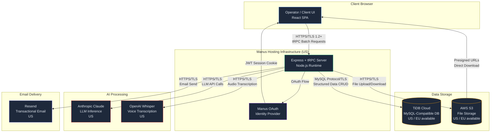

# Data Flow Diagram — VENTEX Platform

**Document Owner:** Aurovia LLC
**Last Updated:** April 16, 2026
**Classification:** Confidential — Share with Clients Under NDA

---

## 1. Overview

This document describes how Client Data flows through the VENTEX platform from ingestion to storage, AI processing, and display. It identifies every point where data crosses a trust boundary or leaves the Aurovia LLC processing environment.

---

## 2. System Architecture Diagram



---

## 3. Data Flow Descriptions

### 3.1 User Authentication

| Step | From | To | Data | Protocol | Notes |
|------|------|----|------|----------|-------|
| 1 | Browser | Manus OAuth | Login credentials | HTTPS/TLS 1.2+ | Credentials never touch VENTEX servers |
| 2 | Manus OAuth | Browser | Authorization code | HTTPS redirect | Short-lived code |
| 3 | Browser | VENTEX Server | Auth code + origin | HTTPS/TLS 1.2+ | Server exchanges code for token |
| 4 | VENTEX Server | Browser | JWT session cookie | HTTPS Set-Cookie | HttpOnly, Secure, SameSite=Lax |

### 3.2 Structured Data Operations (CRUD)

| Step | From | To | Data | Protocol | Notes |
|------|------|----|------|----------|-------|
| 1 | Browser | VENTEX Server | tRPC mutation/query | HTTPS/TLS 1.2+ | Superjson serialization |
| 2 | VENTEX Server | TiDB Cloud | SQL query | MySQL/TLS | Parameterized queries, no raw SQL |
| 3 | TiDB Cloud | VENTEX Server | Result set | MySQL/TLS | Drizzle ORM hydration |
| 4 | VENTEX Server | Browser | tRPC response | HTTPS/TLS 1.2+ | Typed response |

**Tenant Isolation:** Every query includes `organizationId` filter. The `resolveOrgId()` helper enforces this at the procedure level. See WS1 tenant isolation audit for details.

### 3.3 File Upload and Storage

| Step | From | To | Data | Protocol | Notes |
|------|------|----|------|----------|-------|
| 1 | Browser | VENTEX Server | File bytes + metadata | HTTPS/TLS 1.2+ | Multipart upload, 50MB limit |
| 2 | VENTEX Server | AWS S3 | File bytes | HTTPS/TLS 1.2+ | `storagePut()` with randomized key |
| 3 | VENTEX Server | TiDB Cloud | File metadata (URL, key, mime, size) | MySQL/TLS | No file bytes in DB |
| 4 | AWS S3 | Browser | File bytes | HTTPS presigned URL | Time-limited, per-file access |

**Data Residency:** File storage bucket is selected based on tenant `dataResidency` configuration. US tenants use `us-east-1`; EU tenants use `eu-west-1`.

### 3.4 AI Agent Processing

| Step | From | To | Data | Protocol | Notes |
|------|------|----|------|----------|-------|
| 1 | VENTEX Server | Anthropic API | System prompt + venture context + user query | HTTPS/TLS 1.2+ | Data minimization applied |
| 2 | Anthropic API | VENTEX Server | LLM completion | HTTPS/TLS 1.2+ | No data retention by Anthropic |
| 3 | VENTEX Server | TiDB Cloud | Agent event + draft + confidence score | MySQL/TLS | Stored with safety metadata |
| 4 | VENTEX Server | Browser | Agent output with disclaimer | HTTPS/TLS 1.2+ | Human approval required for actions |

**Cross-Border Flag:** If the tenant is configured for EU data residency and the AI call routes to a US endpoint, a `[CROSS-BORDER TRANSFER]` event is logged in the audit trail and tenant consent is verified.

**Data Minimization for AI:** The system sends only the minimum context necessary for the AI operation. Raw financial account numbers, SSNs, and other sensitive PII are stripped before transmission. Document text is truncated to relevant sections.

### 3.5 Document Intelligence Processing

| Step | From | To | Data | Protocol | Notes |
|------|------|----|------|----------|-------|
| 1 | Browser | VENTEX Server | Document file | HTTPS/TLS 1.2+ | PDF, DOCX, XLSX, images |
| 2 | VENTEX Server | Local | Text extraction | In-process | pdf-parse, mammoth, xlsx |
| 3 | VENTEX Server | Anthropic API | Extracted text | HTTPS/TLS 1.2+ | Classification + entity extraction |
| 4 | VENTEX Server | TiDB Cloud | Structured intelligence | MySQL/TLS | Stored in document_intelligence table |

### 3.6 Email Notifications

| Step | From | To | Data | Protocol | Notes |
|------|------|----|------|----------|-------|
| 1 | VENTEX Server | Resend API | Recipient email, subject, body | HTTPS/TLS 1.2+ | Distribution notices, task reminders |
| 2 | Resend | Recipient | Email | SMTP/TLS | SPF/DKIM/DMARC enforced |

**AI-Generated Content:** All AI-generated email drafts include a disclaimer footer and require human approval before sending. See WS3 AI Safety for details.

---

## 4. Trust Boundaries

```
┌─────────────────────────────────────────────────────────────┐
│  TRUST BOUNDARY 1: Client Browser                           │
│  - Session cookie (HttpOnly, Secure)                        │
│  - No direct DB or S3 access                                │
│  - All data flows through tRPC                              │
├─────────────────────────────────────────────────────────────┤
│  TRUST BOUNDARY 2: VENTEX Application Server                │
│  - Tenant isolation enforced at procedure level             │
│  - All external calls authenticated via API keys            │
│  - Audit logging on all sensitive operations                │
├─────────────────────────────────────────────────────────────┤
│  TRUST BOUNDARY 3: Third-Party Sub-Processors               │
│  - DPAs in place with all vendors                           │
│  - Data minimization applied before transmission            │
│  - Cross-border transfers flagged and consented             │
└─────────────────────────────────────────────────────────────┘
```

---

## 5. Data at Rest Encryption

| Storage Layer | Encryption Method | Key Management |
|--------------|-------------------|----------------|
| TiDB Cloud | AES-256 TDE | Provider-managed keys |
| AWS S3 | AES-256 SSE-S3 | AWS KMS |
| Session cookies | HMAC-SHA256 signed JWT | Application-managed JWT_SECRET |
| Sensitive fields (future) | AES-256-GCM application-level | ENCRYPTION_MASTER_KEY |

---

## 6. Data in Transit Encryption

All data in transit uses TLS 1.2 or higher. No unencrypted channels exist in the system. Certificate pinning is not currently implemented but is planned for mobile clients.

---

**`[LEGAL REVIEW REQUIRED]`** — This document requires review by qualified legal counsel and a data protection specialist before distribution to clients.
